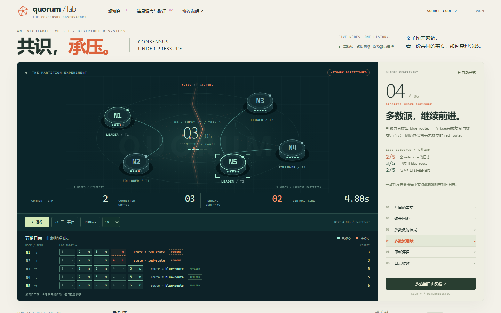

# Quorum Lab

五节点 Raft 共识实验室。切开网络，观察少数派写入停滞、多数派继续提交，以及恢复连接后的日志修复。

**[在线实验 →](https://qiyuhuating.github.io/quorum-lab/)** · [架构](docs/architecture.md) · [路线图](docs/roadmap.md)

TypeScript · React · Web Worker · 虚拟时钟



## 可以做什么

- 自动导览：从正常提交走到网络分区、双领导者并存和日志收敛。
- 注入故障：节点崩溃、单向断链、延迟、丢包；暂停、释放、复制或丢弃在途 RPC。
- 逐事件调试：检查 RequestVote / AppendEntries 载荷、处理分支和接收端前后状态。
- 对比节点：查看任期、投票、日志、commit/applied index 与复制进度。
- 回放与分支：导出种子和操作历史，重建历史前缀，再从选定时刻继续实验。

导览使用种子 7 的六个检查点。控制节点或推进时间后进入自由实验。

## 试一个实验

点击 **载入选票回声**，逐事件投递一份选票回复及其副本：重复回复不会增加独立选民数。释放另一节点的选票，观察候选者获得多数票。

[选票回声](docs/experiments/vote-echo.json) · [旧确认迟到](docs/experiments/stale-ack.json) · [落后节点恢复](docs/experiments/lagging-node.json) · [单向链路故障](docs/experiments/asymmetric.json)

## 本地运行

Node.js **22.12+**。

```sh
git clone https://github.com/qiyuhuating/quorum-lab.git
cd quorum-lab
npm ci
npm run dev
```

运行生产构建：

```sh
npm run build
npm run demo
```

打开 http://127.0.0.1:4173/quorum-lab/ 。Worker 需要 HTTP 环境。

## 验证

```sh
npm run check
npx playwright install --with-deps chromium firefox webkit
npm run test:e2e
npm run benchmark
```

协议、故障回放和浏览器验收记录见 [validation.md](docs/validation.md)；消息调度设计见 [transport-design.md](docs/transport-design.md)。

## 实现范围

固定五节点、基本 Raft、模拟稳定存储和字符串状态机。网络与时钟在单机模拟，基准不代表真实集群吞吐。

尚未实现真实磁盘 IO、快照压缩、成员变更、客户端发现、恰好一次语义和线性一致读。自动写入目标由实验者的全局视图选择。

[MIT](LICENSE) © 2026 qiyuhuating
